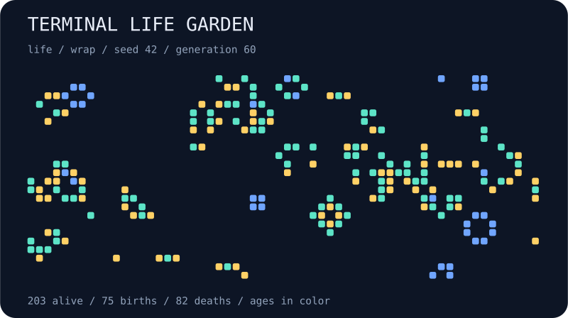

# terminal-life-garden

Grow a tiny cellular-automata garden in your terminal. Start with seeded noise, follow a glider, or inspect an oscillator one generation at a time. Switch between Conway's Life and HighLife while the same board is running.



## Run

```bash
npx --yes github:b69ca/terminal-life-garden
npx --yes github:b69ca/terminal-life-garden --pattern glider
npx --yes github:b69ca/terminal-life-garden --rule highlife --seed 137
```

Node.js 20 or newer. No runtime dependencies. Simulation runs locally.

## Play

| Key | Action |
| --- | --- |
| `p` or Space | Pause / resume |
| `.` | Pause and advance one generation |
| `n` | Reset using the next seed |
| `r` | Reset the current pattern and seed |
| `1` / `2` | Switch to Life / HighLife without clearing the board |
| `+` / `-` | Faster / slower generations |
| `q` or Ctrl-C | Quit and restore the terminal |

`+` marks a newborn cell; `o` marks a survivor. Yellow cells are newborn, cyan cells are younger survivors, and blue cells have survived at least eight generations. Reset starts ages at one. In glider and blinker mode, changing the seed does not change the pattern.

The HUD reports the current population. JSON also reports births and deaths from the most recent generation, density, and the oldest cell age. Ages saturate at 65535.

## Export and reproduce

```bash
npx --yes github:b69ca/terminal-life-garden --width 60 --height 24 --seed 42 --generations 60 --svg garden.svg
npx --yes github:b69ca/terminal-life-garden --pattern blinker --generations 2 --json
npx --yes github:b69ca/terminal-life-garden --generations 60 > garden.txt
```

## Options

```text
--pattern random|glider|blinker  initial pattern (default: random)
--rule life|highlife            rule (default: life)
--edges wrap|fixed              torus or dead outside cells (default: wrap)
--seed N                       unsigned 32-bit seed (default: 42)
--width N                      integer from 5 to 120
--height N                     integer from 5 to 120
--generations N                advance before display; 0–10000
--frames N                     finite terminal session; 0–100000
--json                         print a summary instead of animating
--svg FILE                     save a static SVG instead of animating
--no-color                     disable ANSI colors
--help                         show usage
```

JSON and SVG can be combined. `--frames` cannot be combined with either. A finite session shows the initial displayed board first, then advances between frames. Paused frames still count toward the frame limit.

Without a TTY, output defaults to one plain frame with no escape sequences and a 60 × 24 board. Live defaults fit the terminal at startup. Specify dimensions to reproduce the same seeded board across terminals. `NO_COLOR=1` also disables colors. Quitting restores the cursor, alternate screen, and input mode. Exit codes are 0 for success and 2 for argument or file errors.

## Rules

Life is B3/S23: a dead cell is born with exactly three neighbors; a live cell survives with two or three. HighLife is B36/S23, adding births with six neighbors. Eight neighboring cells are counted, and each generation updates synchronously. Wrapped edges connect opposite sides; fixed edges treat outside cells as dead.

The generator uses a local seeded PRNG and a 30% initial occupancy probability. This is a toy simulation, not a model of biological growth.

## Library

```js
import { createGarden, step, analyze, renderSVG } from 'terminal-life-garden';
const garden = createGarden({ pattern: 'glider', width: 60, height: 24 });
step(garden, 4); // Mutates and returns the garden.
console.log(analyze(garden));
const svg = renderSVG(garden);
```

`cells` is a row-major `Uint16Array` of ages; zero means dead. `analyze()` returns counts and configuration, without the full grid. The exported renderers accept worlds made by `createGarden()`.

## Development

```bash
npm ci
npm run check
```

Tests cover oscillators, glider translation, both rules, edge behavior, population accounting, CLI validation, and SVG output. GitHub Actions runs on Node.js 20, 22, and 24.

## License

MIT
